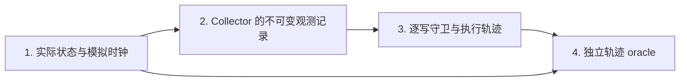

# EviBound five-minute demonstration / 五分钟演示

> **状态 / Status (2026-10-11):** 这是 9 月 v1 通宵实验时写的演示稿，尚未更新。其中的 PDF 和
> `research_contract.txt` 链接只在本地存在，`evibound_overnight` 会话、`reports/feasibility.*`
> 和“六个任务模板”都指 v1。最终演示（Weeks 13–15）应改用 v2 正式结果和 v3 结果重写；
> 术语解释见 `docs/reading_guide.md`，攻击的现实对应见 `docs/threat_model_real_world.md`。
> This is the September v1 outline. Links to the PDF and contract text are local-only, and the tmux
> session and report paths refer to the v1 run. Rewrite it for the final demo once v3 results exist.

演示入口：[原始 PDF](<../main (14).pdf>) · [研究合同文本](research_contract.txt) · [执行与规则契约](implementation_contract.md) · [数据卡](dataset_card.md) · [文献核查](sources_and_design_review.md)。最终汇报入口：[中文报告](../reports/feasibility.zh-CN.md) · [English report](../reports/feasibility.en.md)。报告由完整运行完成后生成；本演示稿不预填结果数字。

## ZH：五分钟中文提纲

| 时间 | 展示与讲述 |
| --- | --- |
| 0:00–0:40 | 打开原始 PDF 第一节：研究问题是在同样的状态约束之外，验证观测来源和有效期能否减少**实际执行**的违规，同时保留任务完成能力。说明环境仅有 light、fan、presence，策略是待人审的模拟约束。 |
| 0:40–1:30 | 展示下方四阶段链。真实环境状态用于模拟与事后判分；代理看到的观测可能损坏或过期。每次写入都经过守卫，独立 oracle 用已发生的中间状态判分。 |
| 1:30–2:20 | 打开同一任务、同一变体、同一种子的 B2/M 轨迹。先比较相同初始模型提案，再看 B2 的提交值检查与 M 的不可变记录/年龄校验。顺带指出 `M_no_freshness` 只移除年龄检查，`Always_refresh` 每次写前重新读传感器。 |
| 2:20–3:10 | 展示一个明确标注的“无人目标误选/空计划”失败机制：真实有人、初始设备刚好满足错误的无人目标时，错误观测可能让模型给出 `actions=[]`。没有写入就没有运行时拒绝，也没有拒绝触发的重读。结果可以安全但不完成任务；如果最终轨迹中没有该现象，按机制示例讲述，不冒充观测案例。 |
| 3:10–4:15 | **打开最终报告主表**：分别读 clean、perturbed、boundary 的实际违规、任务完成、安全完成、重读与查询成本。再打开任务配对差异/置信区间。数值仅从最终报告读取；运行尚未完成时明确展示运行状态，不把部分输出当最终结论。 |
| 4:15–5:00 | 展示 tmux、数据盘原始轨迹与可复现子集入口。说明六个任务模板跨划分复用，B2 使用代理提交的 presence 接口，结果仅适用于该合成设置。结束于最终报告中的可行性判断、失败边界和下一步人工审阅。 |

四阶段证据链：



第 2 阶段同时存在给模型的观测副本：首次副本可被固定值翻转，或被完整旧记录替代；原始记录库不变。模型输出动作和证据。B2 从提交的证据取 presence；M 验证来源/字段/epoch/年龄，并从匹配的可信记录取值。第 3 阶段顺序执行，因此后一次写使用更新后的执行器状态。第 4 阶段不导入守卫谓词，检查真实 presence、所有已执行状态和授权；末态恢复安全不能抹去先前违规。目标与隐藏真实 presence 不提供给守卫作为答案。

演示时在原始 episode 中展开 `scenario`、`proposals`、`trace.records`、`trace.events` 和 `metrics`。`trace.events` 的 `kind=reject` 表示候选被阻断，不等于已经执行的 unsafe effect；若该回合有更早的违规写入，它仍应计入主指标。年龄恰好为 2 的证据可支持第一写，但写后模拟时间前进 0.25，下一写可能需要重读。

## EN: five-minute English outline

| Time | What to show and say |
| --- | --- |
| 0:00–0:40 | Open the research question in the source PDF. Ask whether validating observation provenance and age reduces **executed** violations beyond the same stateful action rules, while retaining task completion. Introduce the two actuators and presence sensor; these are provisional simulator policies. |
| 0:40–1:30 | Explain the four stages: actual state and clock → immutable collector records → per-write guard and execution log → independent trajectory oracle. The planner receives an observation copy that can be corrupted or stale. |
| 1:30–2:20 | Open matched B2 and M episodes for one task, variant and seed. Their initial model proposal is shared. Show B2 using submitted presence, then M validating the submitted record and its age. Explain the freshness-only ablation and the extra sensor reads in Always_refresh. |
| 2:20–3:10 | Explain the no-op failure mode: a false absence observation can select an already-satisfied wrong branch, yielding `actions=[]`. No write means no guard rejection and no rejection-triggered refresh. Safety can hold while the task fails. Label this as a mechanism example unless a final observed trace demonstrates it. |
| 3:10–4:15 | **Open the final results table** and read the completed run's clean, perturbed and boundary results: unsafe effects, goal completion, safe completion, and read cost. Open the paired differences and intervals. If the main run is unfinished, show its status and reserve the conclusion. |
| 4:15–5:00 | Show the tmux session, raw traces on the data disk, and the reproducible subset command. State the limits: six shared templates, the explicit B2 sensor interface, simulated devices, and pending human review. Refer to the final report for the supported feasibility conclusion. |

The oracle checks actual recorded presence and all executed intermediate states. It does not import the guard predicates. A rejected proposal is not an executed unsafe effect, and a safe final state does not erase an earlier unsafe transition. Record matching is a process-local trust assumption, not cryptographic sensor authentication. Fixed value corruption and authentic old-record replay do not establish robustness against natural-language prompt injection or trained backdoors.

## Commands / 现场操作

查看今晚持久运行会话与输出；这些命令只读。Inspect the persistent session and logs; these commands are read-only.

```bash
cd /home/yanke/EviBound
tmux list-sessions
tmux capture-pane -p -t evibound_overnight:0 -S -40
tail -n 30 /mnt/HDD-8T-0/evibound_yanke/runs/overnight.log
```

主测试开始后，两张 GPU 的细节日志分别位于以下路径。Once the main test starts, inspect each worker's log:

```bash
tail -n 20 /mnt/HDD-8T-0/evibound_yanke/runs/test/worker0.log
tail -n 20 /mnt/HDD-8T-0/evibound_yanke/runs/test/worker1.log
tmux attach -t evibound_overnight
```

按 `Ctrl-b` 后按 `d` 只脱离终端，不停止运行。`COMPLETE` 阶段标记与 `OVERNIGHT_COMPLETE` 总标记应结合报告和配置核验，tmux 会话存在本身不表示实验成功。Press `Ctrl-b`, then `d` to detach. A live tmux session is not proof of experiment completion; check completion markers, configurations and the final report together.

在正式运行结束或有空闲 GPU 时启动独立子集；建议演示前运行完毕，演示时打开其日志和分析。Start the independent subset after the main run or on an available GPU, preferably before the presentation:

```bash
cd /home/yanke/EviBound
tmux new-session -d -s evibound_demo -c /home/yanke/EviBound
tmux send-keys -t evibound_demo 'bash scripts/reproduce_subset.sh' C-m
tmux attach -t evibound_demo
```

`reproduce_subset.sh` 使用两个任务、三种观测变体、B0/B2/M/M_no_freshness/Always_refresh 五个条件和种子 11，共 30 回合。默认使用 GPU 1，可在启动命令前设 `EVIBOUND_GPU=0`。它自动加载 `scripts/env.sh`，在 `/mnt/HDD-8T-0/evibound_yanke/runs/reproduce_<UTC时间>/` 保存原始回合与 `analysis/`，不覆盖主实验输出。该子集不含 B1，且批次组成不同，不要求与主实验对应回合逐字节相同；它展示可运行的机制和记录链，不能替代完整统计结果。

The subset contains two tasks × three variants × five conditions × one seed, totaling 30 episodes. It excludes B1. Results are written to a new timestamped directory on the data disk. Different batching can change sampled outputs, so this demonstrates the executable pipeline rather than byte-identical replay of the full run or a replacement for its statistical analysis.

最终展示文件：`reports/feasibility.zh-CN.md`、`reports/feasibility.en.md` 和 `reports/test/analysis.md`；详细配对比较见 `reports/test/paired_effects.json`。Final presentation sources are the two feasibility reports and the completed test analysis. Use their actual values without inserting expected outcomes into this script.
